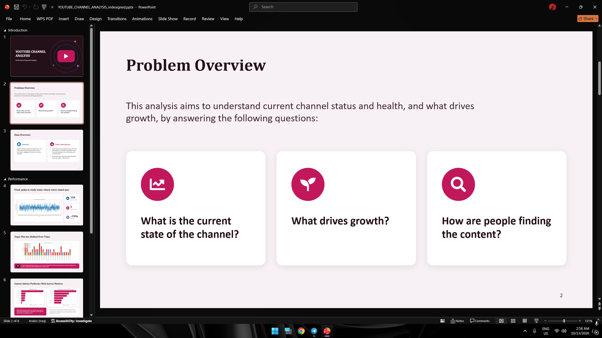
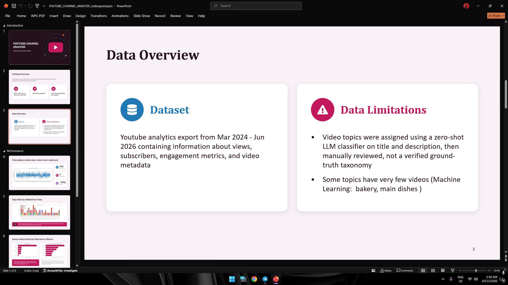
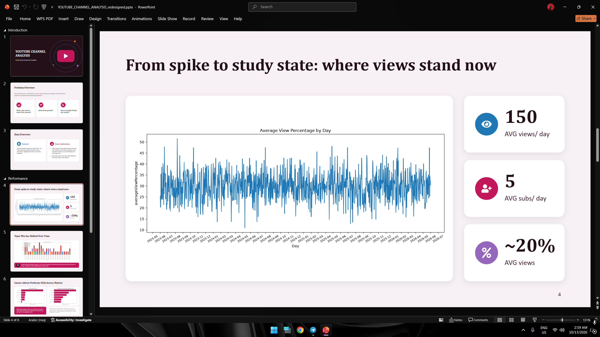
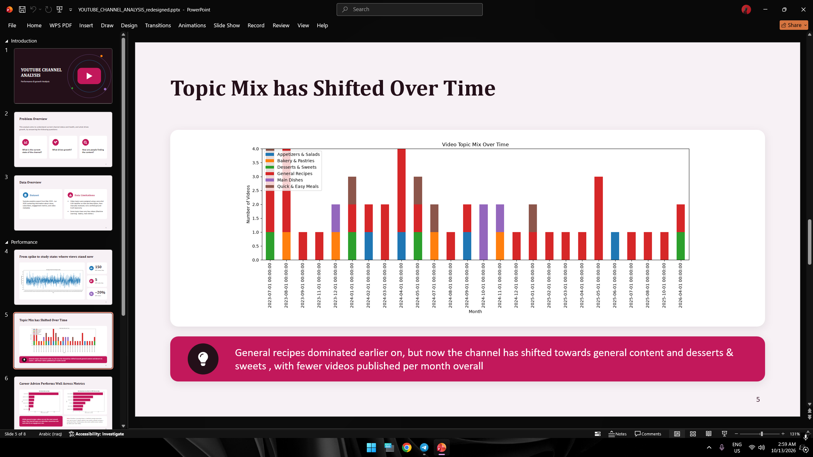
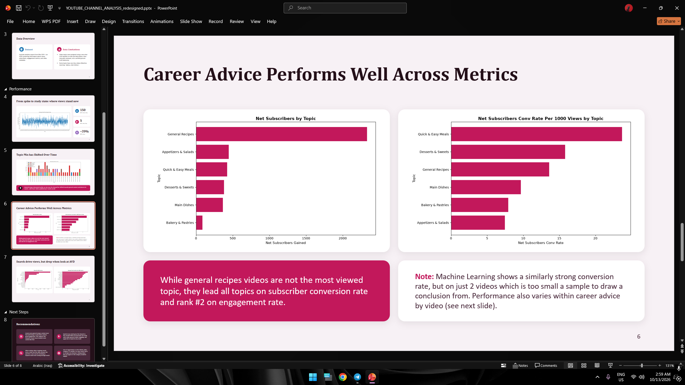
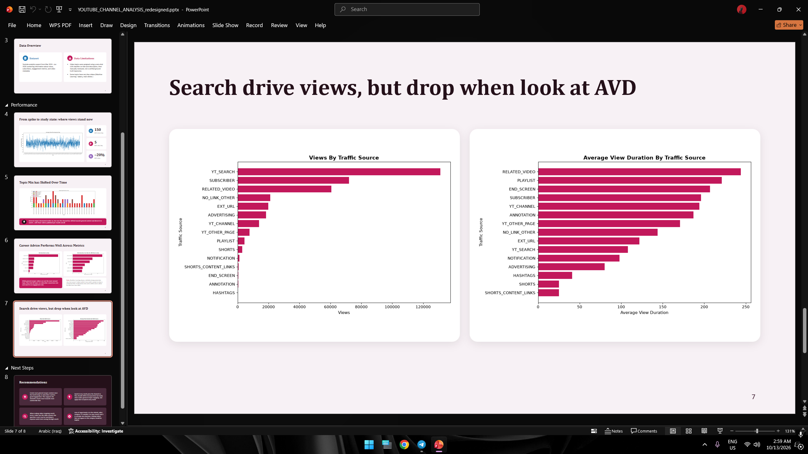
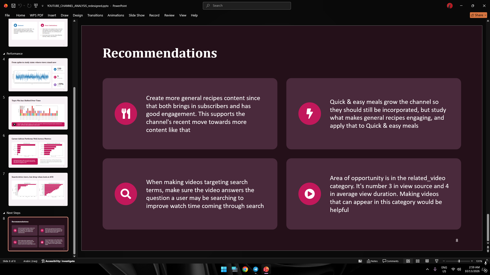

# YouTube Channel Performance & Growth Analytics | Freelance Project

---

## Overview

This is a real-world freelance data analytics project analyzing performance metrics for a YouTube channel. 

The primary objective was to evaluate channel health, subscriber behavior, and topic performance, ultimately delivering data-driven recommendations to help the content creator maximize growth and audience retention.

---

## Problem Overview & Analytical Questions

The project focuses on answering three core operational questions:
1. What is the current state and overall health of the channel?
2. What specific content types drive subscriber growth and retention?
3. How are viewers discovering the channel's content?

---

## Data Pipeline & Limitations

* **Dataset:** Exported directly from YouTube Studio covering performance metrics from **March 2024 to June 2026** (views, subscribers, engagement, metadata).
* **Processing & Classification:** Cleaned and analyzed using **Python (Pandas, NumPy, Matplotlib)**. Video topics were categorized using a zero-shot LLM classifier on titles and descriptions, followed by manual review.

---

## Key Analytical Findings

### 1. Overall Channel Health
* Daily averages stabilized at **~150 views/day** and **~5 subscribers/day**, with an average view percentage around **20%**.

### 2. Topic Mix Trends
* **Shift Over Time:** Early channel growth was dominated by `General Recipes`. Over time, publication shifted towards general content and `Desserts & Sweets`, with fewer total videos published per month.

### 3. Conversion Rate & Engagement by Topic
* **Top Performers:** While `General Recipes` bring high total subscribers, topics like `Quick & Easy Meals` show the highest subscriber conversion rate per 1,000 views.

### 4. Traffic Sources vs. Average View Duration (AVD)
* **Search vs. Suggested:** `YouTube Search` brings the highest total view volume, but `Related Videos` (Suggested) and `Playlists` yield significantly higher **Average View Duration (AVD)**.

---

## Recommendations & Actionable Growth Strategy

| Area | Strategic Recommendation |
| :--- | :--- |
| **Content Strategy** | Increase frequency of `General Recipes` and `Quick & Easy Meals` to balance high subscriber growth with strong retention. |
| **Search Optimization** | Ensure search-targeted videos answer user queries directly to improve watch time coming from search traffic. |
| **Suggested Videos** | Structure videos to appear in the `Related Videos` sidebar to leverage higher Average View Duration (AVD). |

---

## Tools Used

* **Python:** Pandas, NumPy, Matplotlib
* **Data Sources:** YouTube Studio Export (CSV)
* **Reporting & Presentation:** Microsoft PowerPoint
